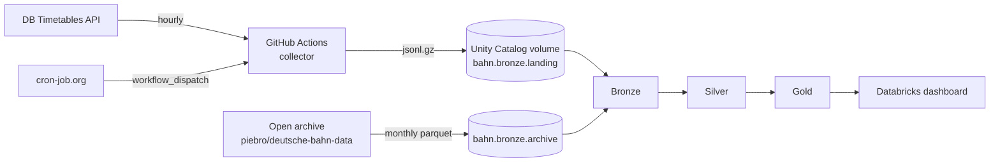

# Bahn pünktlich

How punctual are Deutsche Bahn trains at Germany's big stations, if a cancelled train counts as late?

DB publishes one punctuality figure per month. A stop counts as punctual when the train arrives less than 6 minutes late, and cancelled trains are left out of the calculation. A train that never came does not make the figure worse. This project collects the timetable and change data itself, recomputes punctuality by station, line and hour of day, and reports two numbers side by side: DB's definition, and the same with cancellations counted as failures.


## What the data shows so far

Long-distance trains (ICE, IC, EC and similar) at the 25 stations tracked here, May to July 2026, measured the way DB measures:

| Month | DB's published figure (whole network) | These stations, DB's definition | These stations, cancellations counted |
|---|---|---|---|
| May 2026 | 61.1 % | 53.5 % | 51.5 % |
| June 2026 | 52.6 % | 43.7 % | 40.7 % |
| July 2026 | 52.6 % | 42.9 % | 40.2 % |

- The big hubs are 7 to 10 points worse than the network average. Delays add up along a route, and the hubs are where most routes meet.
- Counting cancellations costs another 2 to 3 points every month.
- The Ruhr stations (Düsseldorf, Essen, Dortmund) are the worst in the set, followed by Köln.
- In the week of 22 June every train class dropped at the same time. Long-distance fell to about 27 %.
- Long-distance trains leave on time in the morning. From midday on, the hubs turn orange on the hour-of-day heatmap and stay that way until late evening.
- FlixTrain's FLX10 (Berlin to Stuttgart) was on time at 22 % of its stops, and 1 in 5 of its stops was cancelled.

Numbers as of 16 October 2026. August and September are being loaded, and the hourly collector adds a day of data every day.

## How it works



**Collector** (`collector/collect.py`). Runs every hour on GitHub Actions. For each station it calls the change feed (`fchg`) once and the planned timetable (`plan`) for the current hour and the next two. The responses are stored unparsed, one JSON line per call, gzipped, and uploaded to a Unity Catalog volume through the Databricks Files API. The client throttles itself to stay under the API's 60 calls per minute, retries on 429 and 5xx, and stops the run at the first 401 or 403 instead of burning through the quota.

GitHub's own cron dropped about three out of four scheduled runs, so the workflow is started from cron-job.org through the `workflow_dispatch` API at minute 7 of every hour.

**Archive** (`scripts/backfill_archive.sh`). The open dataset [piebro/deutsche-bahn-data](https://huggingface.co/datasets/piebro/deutsche-bahn-data) has the same IRIS data back to 2024. One month is about 15 million rows. Its timestamps are nanosecond precision, which Spark cannot read, so `scripts/convert_timestamps.py` rewrites them to microseconds and splits each month into parts of 2 million rows. Single uploads of a whole month kept failing with broken pipes.

**Bronze** (`pipelines/bronze.py`). Auto Loader reads both landing folders into Delta tables without changing anything. If silver has a bug, it can be rebuilt without calling the API again.

**Silver** (`pipelines/silver.py`).
- The XML is parsed in a Python UDF (`transform/iris.py`) into one row per stop.
- The API reports a stop in pieces: the plan has the scheduled times, the change feed adds delays, platform changes and cancellations, often several times as a delay grows. `AUTO CDC` merges these into the latest state per stop. `ignore_null_updates` keeps a change record from wiping out the planned time it never sent.
- All times are converted from German local time to UTC with an explicit zone, so the result does not depend on the Spark session's time zone. The night the clocks go back has its own test.
- The archive is renamed to the same columns, and both sources end up in one table, `train_stops`.

**Gold** (`pipelines/gold.py`, logic in `transform/gold.py`).
- Big stations are split across several station numbers. Berlin Hbf has its own number, but its trains are listed under the underground hall and the S-Bahn platforms. `stations.csv` lists all of them with a `parent_eva`, and gold rolls them up to the station.
- Each stop is measured once: at arrival, the way DB does it. A train's first stop is left out, as in DB's figure.
- For each station and day only one source counts, the collector if it has that day, otherwise the archive.
- `collection_health` has one row per polled station number and day, including the zeros. A station that answers the API but returns no trains looks like a successful run in the collector's log. Here it shows up as a failed expectation.

## Decisions worth explaining

**Why not just trust the HTTP 200.** Four Berlin stations returned valid, empty timetables for days. Their trains are filed under other station numbers listed in the `meta` attribute of the station lookup. `collect.py expand-meta` adds those numbers. `prune-meta` drops the ones that turn out to be bus stops in front of the station, and stops polling parent numbers that never carry trains themselves.

**Why the first stop is left out.** With first stops included, May came out at 58.6 %, close to DB's 61.1 %. It looked like a match. But trains rarely leave their first station late, and DB does not count first stops. Measured the same way as DB, the hubs are clearly worse than the network.

**Why some days are dropped and others are not.** The archive's May file carries a few late trains from 30 April, and those few are almost all late. The collector started in the middle of 13 October. Such days are only partly covered, so a station's first and last day in a source are dropped if they have less than half its usual traffic. Thin days in the middle are kept. They are usually closures for construction work, like the S-Bahn tunnels in München and Stuttgart on some weekends in May, and travellers live through those.

**Why FlixTrain is a separate class.** DB's figure covers DB trains only.

**Why lines carry a region.** Line numbers repeat across Germany. RE2 runs in Berlin-Brandenburg and in NRW, S1 in five cities.

## Stack

Python, PySpark, Databricks (Free Edition): Lakeflow Spark Declarative Pipelines, Auto Loader, AUTO CDC, Unity Catalog volumes, AI/BI dashboard. GitHub Actions for collection and tests. pytest with a local Spark session, ruff.

## Repository

```
collector/          hourly API collector and stations.csv
pipelines/          bronze, silver, gold (Lakeflow declarative pipeline)
transform/          parsing and column logic, kept free of Databricks imports so it can be tested locally
scripts/            archive backfill
setup/              catalog, schemas and volumes
tests/              47 tests, the Spark ones run on a local session
.github/workflows/  collect.yml (hourly), tests.yml (every push)
```

## Running it yourself

You need a DB API Marketplace account subscribed to the Timetables API, and a Databricks workspace. Free Edition is enough.

```bash
python -m venv .venv && source .venv/bin/activate
pip install -r requirements.txt -r requirements-dev.txt
pytest -q

cp .env.example .env        # DB_CLIENT_ID, DB_API_KEY, DATABRICKS_HOST, DATABRICKS_TOKEN
set -a; source .env; set +a
python -m collector.collect check-stations
python -m collector.collect run
```

In Databricks, run the two SQL files in `setup/`, then create a pipeline with the three files in `pipelines/` as source. For the history, `./scripts/backfill_archive.sh 2026-05 2026-06` loads months from the archive.

## Limitations

- 25 stations, chosen as the largest hubs plus the Berlin area. These are not DB's network-wide numbers and should not be compared with them one to one.
- When the collector misses a run, a stop keeps its last known state. A delay reported only in the missed hour is lost. `collection_health` shows gaps per station and day.
- Long-distance trains have no line number in the data, so the line ranking covers regional trains, S-Bahn and FlixTrain.

## Data and licence

- Timetable and change data: [Deutsche Bahn Timetables API](https://developers.deutschebahn.com/) via the DB API Marketplace.
- Historical data: [piebro/deutsche-bahn-data](https://huggingface.co/datasets/piebro/deutsche-bahn-data), CC BY 4.0.
- DB's published punctuality figures: [deutschebahn.com, Pünktlichkeitswerte](https://www.deutschebahn.com/de/konzern/konzernprofil/zahlen_fakten/puenktlichkeitswerte-1187696).
